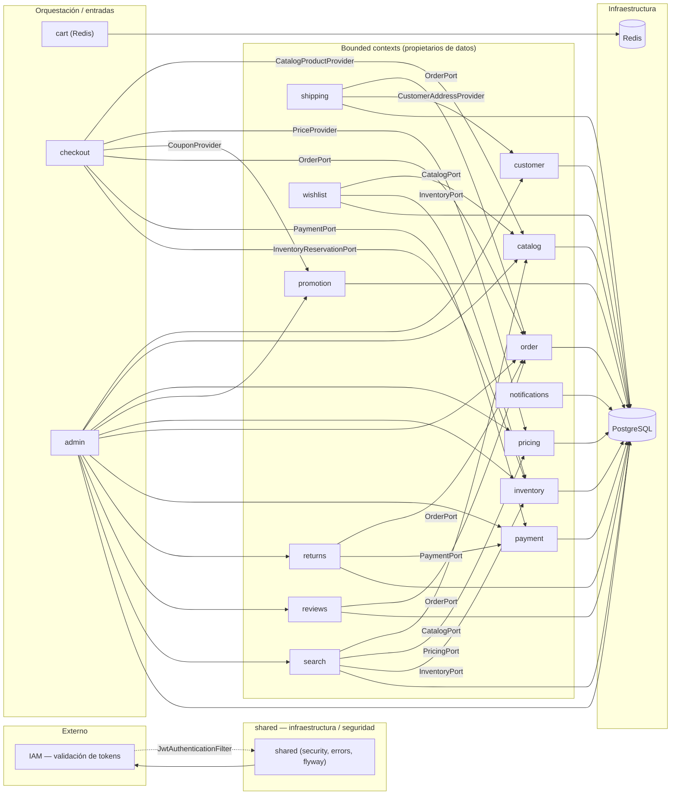

# Diagrama de componentes — E-Commerce (monolito modular hexagonal)

Vista de alto nivel de los bounded contexts y sus dependencias (solo por puertos de aplicación).

## Notas

- **Dependencias solo por puertos** (`application/port/in` de otros contextos): nunca se accede al repositorio o dominio de otro contexto.
- `cart` y `checkout` no poseen tablas: el carrito vive en Redis y checkout es capa de orquestación.
- `order` no consume puertos de otros contextos: captura los precios/snapshots en el comando de creación.
- `shared` incluye Spring Security (filtro JWT con validación remota contra IAM), manejador global de errores y las migraciones Flyway comunes.