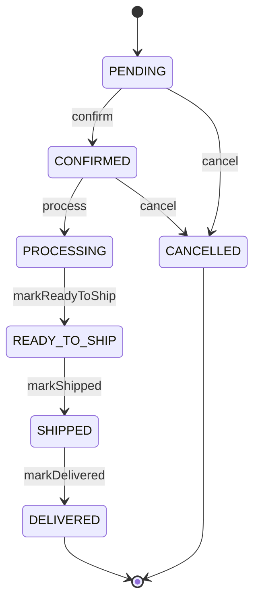
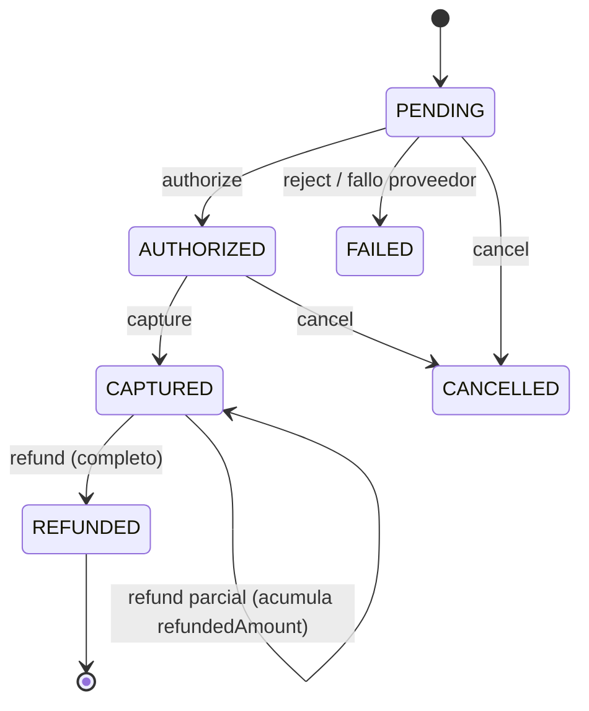
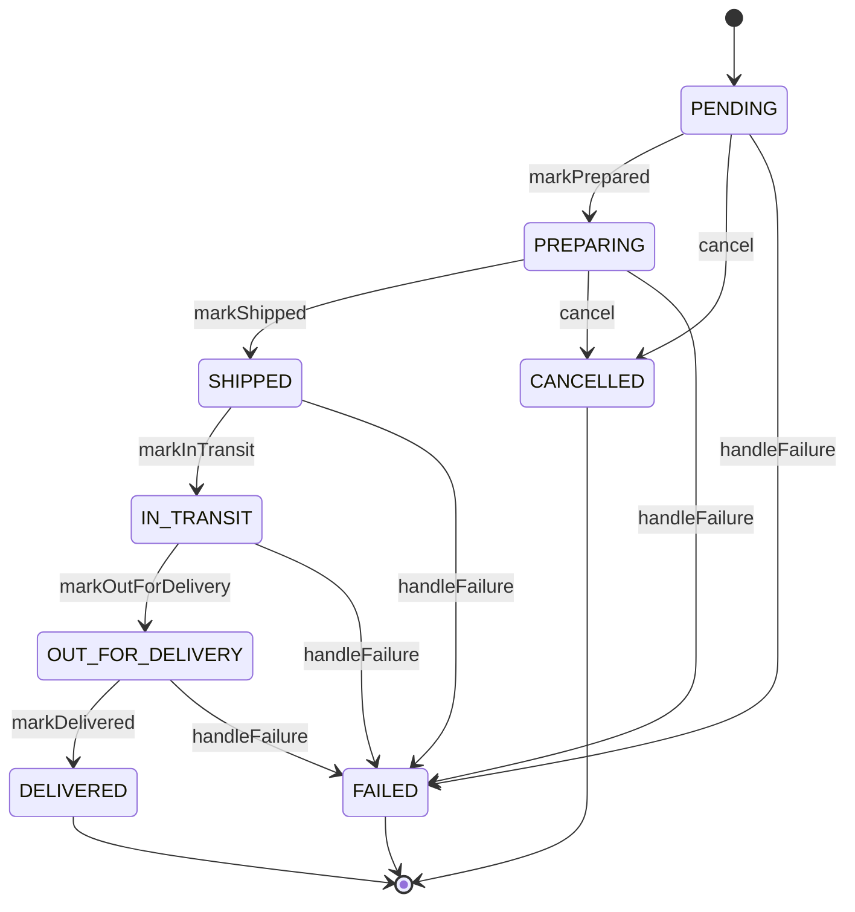
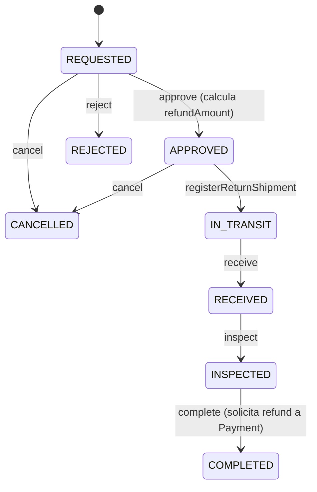
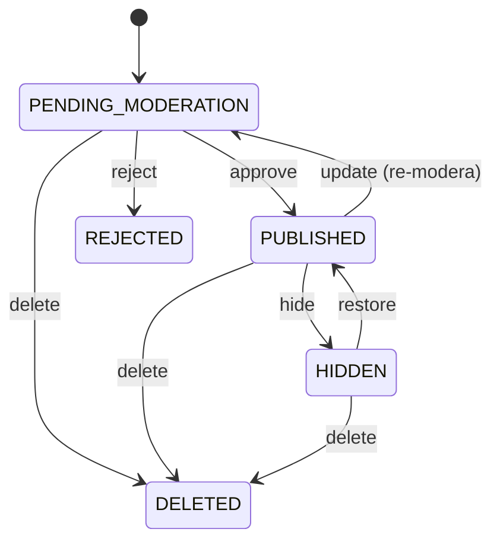
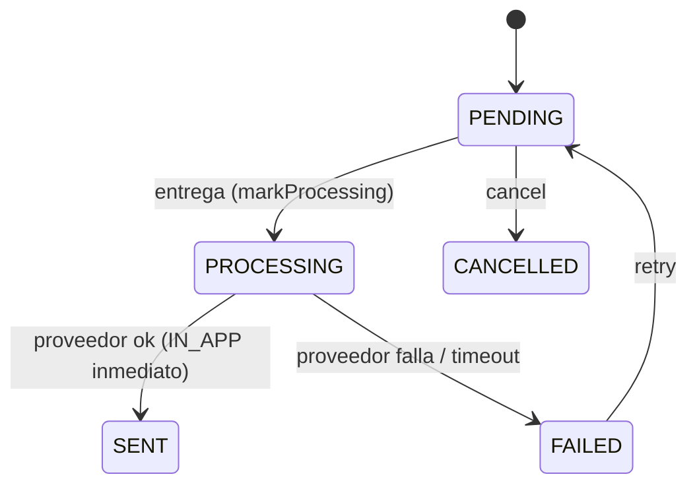
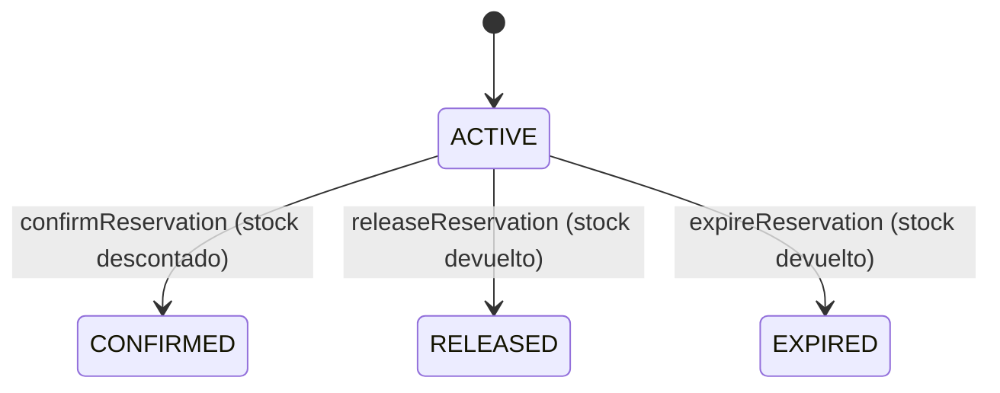

# Diagramas de estados — E-Commerce

Máquinas de estado de los agregados clave, extraídas del dominio (`requireTransition`).

## Order

## Payment

## Shipment

## Return

## Review

## Notification

## Stock reservation

