# Diagramas de secuencia — E-Commerce

Flujos representativos entre contextos (dependencias solo por puertos).

## 1. Checkout (dos fases: start + confirm)

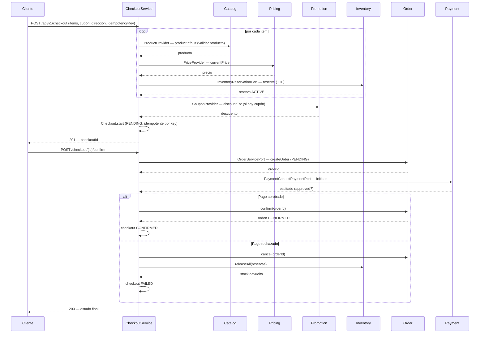

## 2. Fulfillment y envío (orden → shipping → entrega)

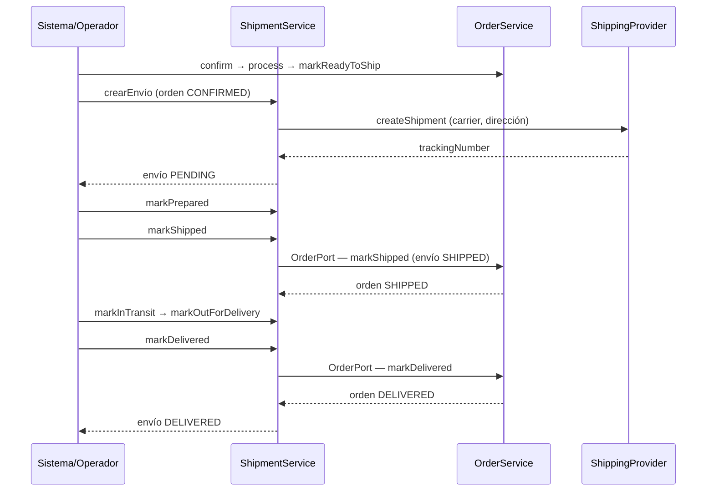

## 3. Devolución y reembolso (returns → payment)

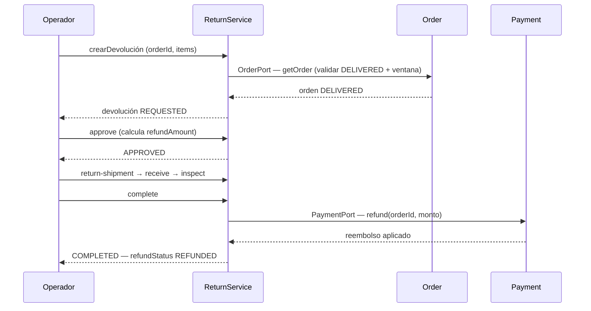

## 4. Indexación de búsqueda (search index)

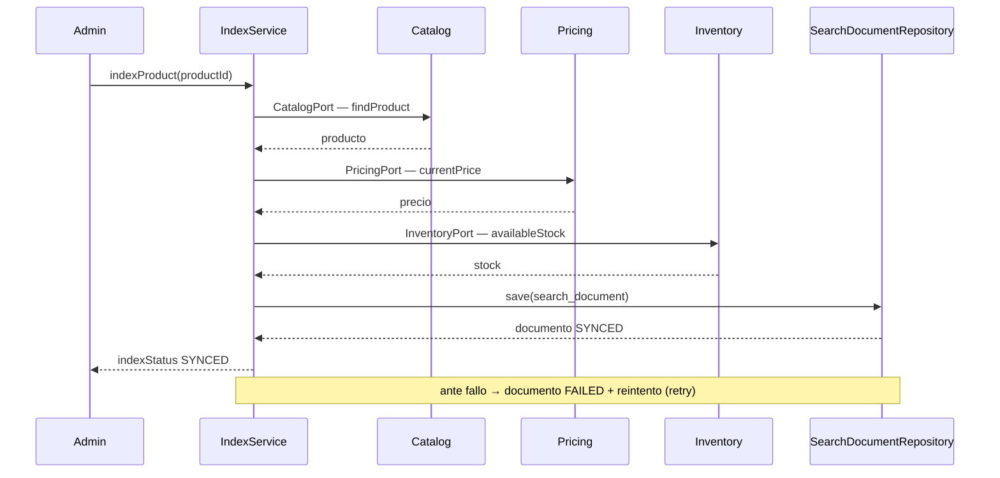

## 5. Operación administrativa con auditoría

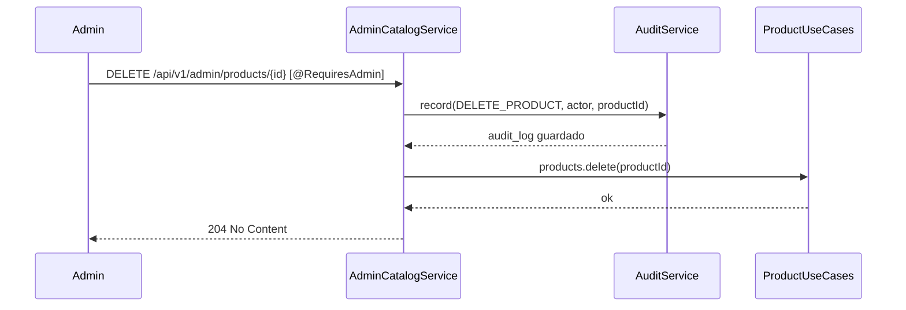
## 6. Webhook de pago (proveedor → payment)

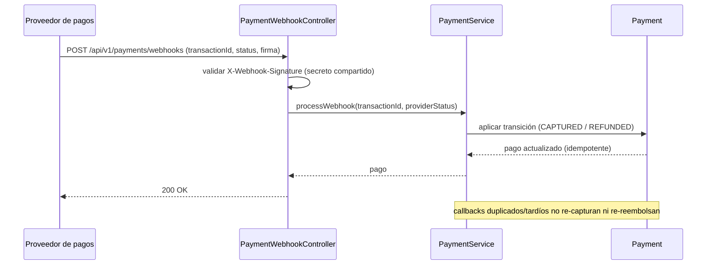

## 7. Webhook de envío (proveedor → shipping → order)

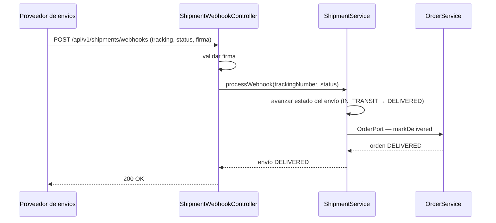

## 8. Ciclo de reservas de inventario

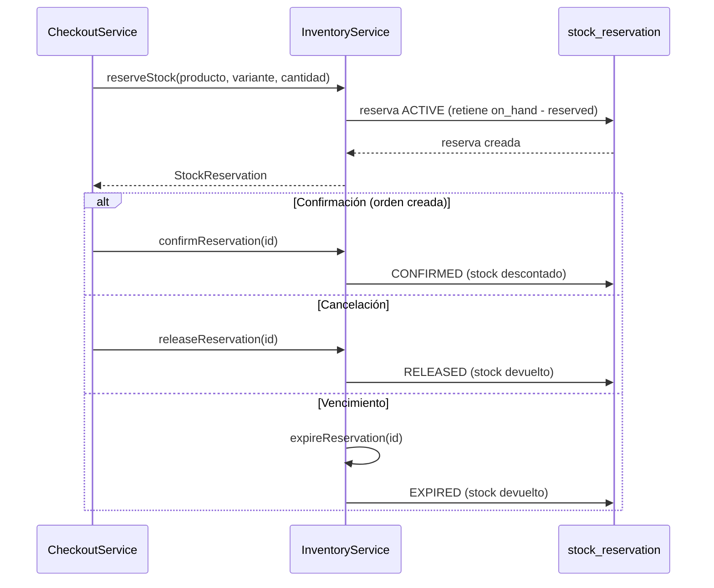

## 9. Creación de review y moderación

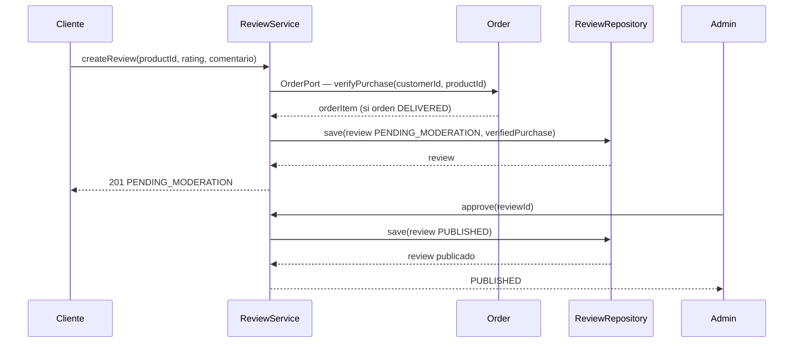

## 10. Wishlist: añadir item con validación

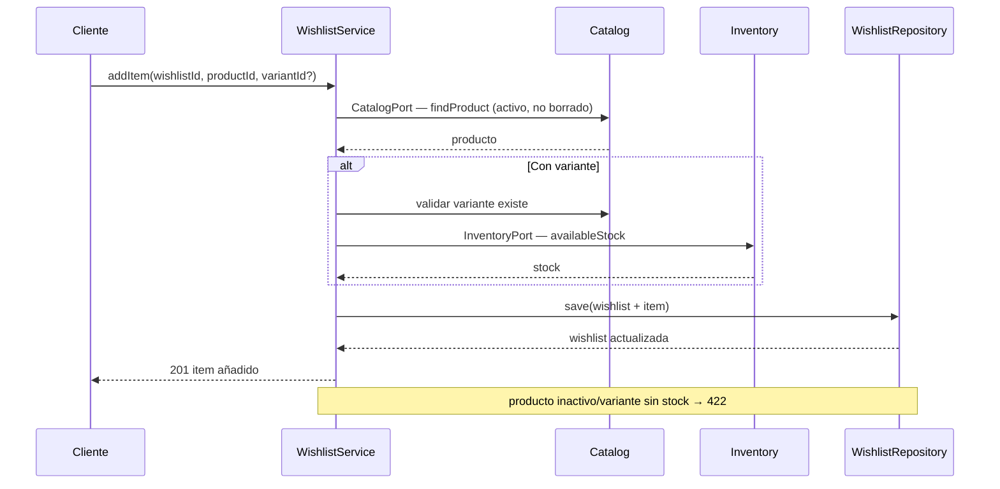

## 11. Notificación: entrega y reintento

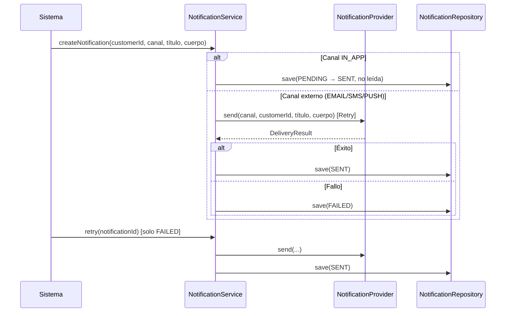

## 12. Búsqueda de productos

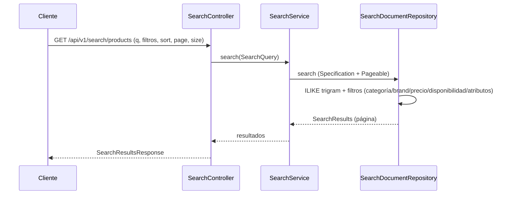
